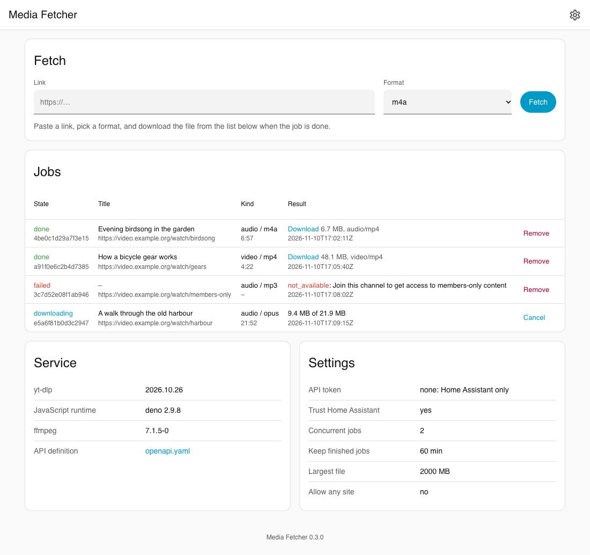
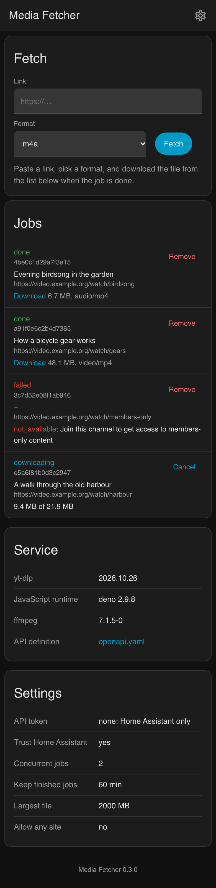
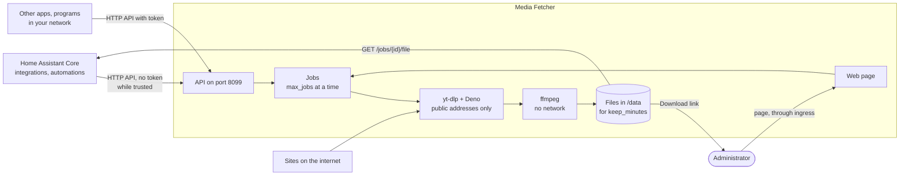

# Media Fetcher app for Home Assistant

[](LICENSE)


A Home Assistant app that fetches audio or video from links [yt-dlp](https://github.com/yt-dlp/yt-dlp) understands and serves the file over a small HTTP API in Home Assistant's app network, for integrations, scripts and automations. It brings [Deno](https://deno.com/) as yt-dlp's JavaScript runtime, which many sites require today and which Home Assistant's own images lack, and ffmpeg for conversions to m4a, mp3, opus, flac, wav, mp4 or mkv. Its page in Home Assistant fetches a link by hand and lists the jobs with a download link for each file.

Requires Home Assistant 2026.11 or later.

## Screenshots

The page looks like Home Assistant's own settings and follows the theme in use. The jobs on these pictures are made up.





## Overview



A client asks what a link holds (`info`) or starts a job; yt-dlp fetches the media from the site, ffmpeg converts it, and the file waits in the app's data for `keep_minutes`, until the client picks it up or deletes it. Links to your own network are refused, files are limited by `max_size_mb` and by the free space of Home Assistant's data partition. The [documentation](media_fetcher/DOCS.md) has the options, the API with the job states, examples and limitations; changes are in the [changelog](media_fetcher/CHANGELOG.md).

## Installation

1. Add the repository to your Home Assistant instance:

   [](https://my.home-assistant.io/redirect/supervisor_add_addon_repository/?repository_url=https%3A%2F%2Fgithub.com%2Fn-schilling%2Fha-app-media-fetcher)

   Or add it manually: **Settings → Apps → Install app → ⋮ → Repositories**, then paste:

   ```text
   https://github.com/n-schilling/ha-app-media-fetcher
   ```

2. Install **Media Fetcher**, review the options and start it. The Supervisor builds the image on your machine; that takes a few minutes.

## Development

The service is a Python package in [`media_fetcher/rootfs/usr/lib/media_fetcher`](media_fetcher/rootfs/usr/lib/media_fetcher): `api.py` (aiohttp, the page), `jobs.py` (threads, files, cleanup), `fetcher.py` (yt-dlp options, limits and error mapping). The page's look comes from the stylesheet shared by these apps, [`ha.css`](media_fetcher/rootfs/usr/local/share/ha-app/ha.css), which stays identical in every app. The tests replace `yt_dlp.YoutubeDL` with a fake and need no network. Set up both Pythons the CI tests with (3.13 is the image's) and run every check:

```bash
uv venv -p 3.13 .venv && uv pip install -p .venv --require-hashes -r media_fetcher/requirements.txt && uv pip install -p .venv -r requirements_test.txt
uv venv -p 3.14 .venv-314 && uv pip install -p .venv-314 --require-hashes -r media_fetcher/requirements.txt && uv pip install -p .venv-314 -r requirements_test.txt
scripts/check.sh
```

`scripts/check.sh` runs what CI runs: changelog, shellcheck, ruff, the tests with coverage on both Pythons and, with Docker, the image build with its start checks (`--no-image` skips them). The app linter and the AppArmor test (`tests/apparmor.sh`, which needs a kernel with AppArmor) run in CI only.

The packages are pinned with hashes; after changing `media_fetcher/requirements.in`:

```bash
cd media_fetcher && uv pip compile requirements.in --generate-hashes --universal --python-version 3.13 -o requirements.txt
```

The screenshots come from the page's own code with made-up jobs, in a headless browser:

```bash
uv run --with playwright==1.65.0 --with-requirements media_fetcher/requirements.in python scripts/screenshots.py
```

A local image for a real run, with a fixed token:

```bash
docker build --build-arg BUILD_VERSION=dev -t media-fetcher:dev media_fetcher
mkdir -p /tmp/mf && echo '{"token": "dev-token", "trust_home_assistant": true, "max_jobs": 2, "keep_minutes": 60, "max_size_mb": 2000, "allow_any_site": false, "log_level": "debug"}' > /tmp/mf/options.json
docker run --rm -p 8099:8099 -v /tmp/mf:/data media-fetcher:dev
```

Releases: work happens on `dev`, raise `version` in `media_fetcher/config.yaml` and add its section to the changelog; when CI is green there, `dev` goes to `main`, and a green CI run on `main` tags the version from `config.yaml` and publishes a release with its changelog section.

## Support

Questions, bugs and ideas: [open an issue](https://github.com/n-schilling/ha-app-media-fetcher/issues/new/choose) in this repository. Security problems: see [SECURITY.md](SECURITY.md).

## License

[Apache License 2.0](LICENSE)
