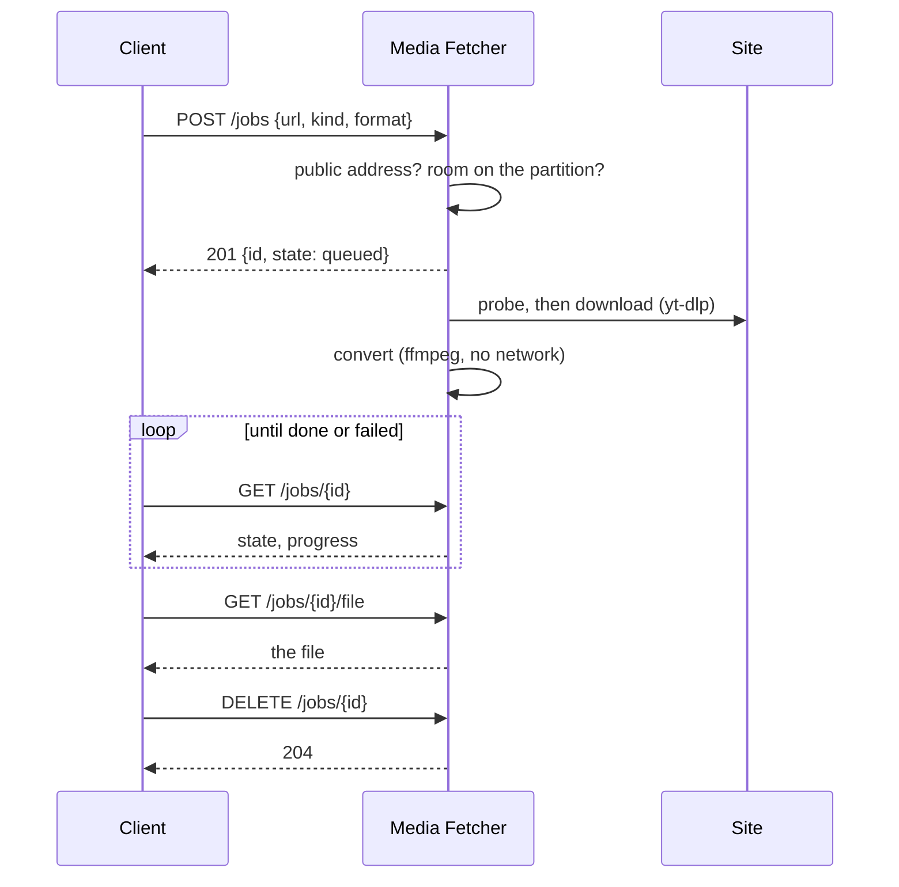
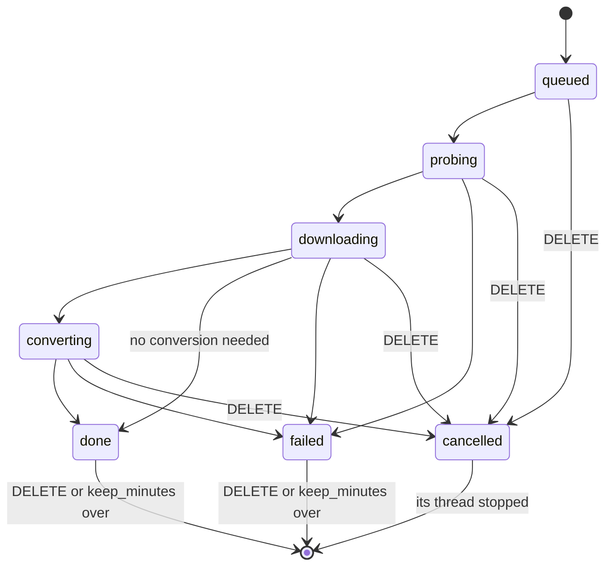

# Media Fetcher

A small HTTP service in Home Assistant's app network that fetches audio or video from links [yt-dlp](https://github.com/yt-dlp/yt-dlp) understands and hands the file to whoever asked: an integration, a script, an automation, or you on the app's page. It brings what yt-dlp needs and Home Assistant's own images do not have: [Deno](https://deno.com/) as a JavaScript runtime, which many sites require today, and ffmpeg for conversions.

It is not tied to one site or one use: `info` tells what a link holds, a job fetches it as m4a, mp3, opus, flac, wav, mp4 or mkv, and the file is yours to pick up for a while.

## Requirements

- Home Assistant OS or Supervised, aarch64 or amd64, Home Assistant 2026.11 or later
- Internet access for the sites you fetch from
- Room on Home Assistant's data partition for the files: up to `max_size_mb` per job while it waits to be picked up; no job runs while less than 1 GiB is free

## Options

Under **Settings → Apps → Media Fetcher → Configuration**.

| Option | Default | Meaning |
|---|---|---|
| `token` | | API token for clients other than Home Assistant Core. Empty: there is none, and the API answers Home Assistant alone. Set: other apps and, with the port mapped, programs in your network send it |
| `max_jobs` | `2` | Jobs that run at the same time, and links `info` looks at at the same time; further requests get `429 busy` until one finishes |
| `keep_minutes` | `60` | Minutes a finished job and its file stay available; then they are deleted. Everything is deleted when the app starts |
| `max_size_mb` | `2000` | Megabytes (millions of bytes) a fetched file may have. A larger one fails with `too_large`: before the download when the site tells the size, during it when it grows past the limit, after a conversion that would make it larger |
| `allow_any_site` | `false` | Also use yt-dlp's *generic* extractor, which tries to fetch media from any public site. Off, only sites yt-dlp has an extractor for are fetched |
| `log_level` | `info` | How much the app writes to its log: `debug` (with every message of yt-dlp, warnings included), `info`, `warning` or `error` |

## Web page

**Open web UI** on the app's page opens a page that only answers Home Assistant's ingress proxy, so only administrators see it. It looks like Home Assistant's own settings, follows the theme in use and never shows the token.

- **Fetch:** paste a link, pick a format (audio m4a, mp3, opus, flac, wav or the source's own format; video mp4, mkv or the source's own container) and press *Fetch*. The job appears in the list below; when it is done, its row has a **Download** link that saves the file under the media's title.
- **Jobs:** every job with its state, progress or result, and a *Cancel* or *Remove* button. The list refreshes every 10 seconds; jobs started through the API are there too. On a phone each job is one block.
- **Service and Settings:** the versions of yt-dlp, the JavaScript runtime and ffmpeg, a link to download the API definition (`openapi.yaml`), and the options in use. The gear at the top opens the app's options.
- The app's name and version stand at the bottom of the page.

The page talks to endpoints of its own that take no token; the ingress session is their lock, and the ones that change something take JSON with an `X-Requested-With` header only, which a form on another site cannot send.

## API

Base: `http://<host>:8099/api/v1`, JSON in and out. The host is the app's name in the app network: its slug with dashes, e.g. `local-media-fetcher` for a locally installed copy. An integration finds the app through the Supervisor's list of installed apps (a slug that ends in `_media_fetcher`, the host name from the slug, port 8099); the app sends no discovery message. The whole API is described in [`openapi.yaml`](rootfs/usr/lib/media_fetcher/openapi.yaml) (OpenAPI 3.1), which the service also serves at `GET /api/v1/openapi.yaml` without a token.

### Who gets in

- **Home Assistant Core needs no token.** Core runs in the host's network, so its requests enter the app network from the network's address on the host, 172.30.32.1. Requests from that address pass without a token. The app looks at the connection's own address only, never at a forwarded header. The same address belongs to everything else that runs in the host's network: apps with `host_network`, the operating system itself and, with the port mapped, connections Docker's proxy hands on from the host. Know which apps run in the host's network.
- **Everyone else needs the token.** Other apps, and clients in your network when the port is mapped, send `Authorization: Bearer <token>` on every request but `health` and `openapi.yaml`, with the token from the `token` option. With the option empty (the default) there is no token, and the API answers Home Assistant Core alone. A set token stays the same across restarts; treat it like a password, it never appears in the log.
- **Outside the app network.** The API is not reachable from your network unless you map the port under **Network** on the app's page. Do that only with a token set and a network you trust: the token crosses it in clear text, there is no TLS and no rate limit. Never expose the port to the internet.

Whoever gets in can make the app fetch from the internet and read the files of every job.

### What the app refuses to fetch

- **Your home network is out of bounds.** Before yt-dlp runs, the app resolves the link's host and refuses the link when the address part is not a plain `host[:port]`, when the host does not resolve, or when any of its addresses is not public: loopback, private ranges, link-local, the Supervisor's network, and IPv6 addresses that carry one of these (IPv4-mapped and NAT64). While yt-dlp runs, every name it resolves goes through the same check, so a redirect or a page that points to a device in your network ends in an error as well.
- **Only yt-dlp's own downloaders fetch.** A stream that would need ffmpeg, rtmpdump or another program to fetch it (RTMP, RTSP, MMS and other rare protocols) is refused as `unsupported_url`, and an HLS stream that yt-dlp would hand to ffmpeg halfway fails with `download_failed`, because those programs resolve names on their own.
- **ffmpeg, ffprobe and Deno have no network.** They run under an AppArmor profile without network access, ffmpeg reads local files only, and a download that starts as text (a playlist or manifest in place of media) fails as `convert_failed` before ffmpeg sees it.
- **`allow_any_site` widens the reach.** yt-dlp's generic extractor tries any public site it is given and follows what it finds there. Leave it off unless you need sites without an extractor, and then give the token only to clients you trust.
- Jobs run with yt-dlp's cache off, without cookies or a login, only with the extractors of yt-dlp's default set (minus the generic one). What needs an account stays out of reach. Whether you may copy what you fetch is your business: the terms of the site and the rights of the owner apply.

### Errors

```json
{"error": {"code": "not_available", "message": "Video unavailable. This video is not available"}}
```

yt-dlp's message is shortened to its first line, at most 200 characters, without the `ERROR: [site] id:` prefix. Every endpoint but `health` and `openapi.yaml` answers `401 unauthorized` to a request that neither comes from Home Assistant Core nor carries the token.

### `GET /health`

No token needed from anyone. The versions the service runs with; `js_runtime` or `ffmpeg` is `null` when missing.

```json
{"ok": true, "version": "0.3.0", "yt_dlp": "2026.10.26", "js_runtime": "deno 2.9.8", "ffmpeg": "7.1.5-0"}
```

### `POST /info`

What a link holds, without downloading. Body: `{"url": "https://…"}`.

```json
{"id": "abc123", "title": "Evening birdsong in the garden", "duration": 417, "uploader": "Someone", "extractor": "youtube",
 "webpage_url": "https://www.youtube.com/watch?v=abc123", "thumbnail": "https://…", "is_live": false}
```

`duration` is in whole seconds, or `null` when the site does not say. A link to one video of a playlist is that video; a playlist itself is not resolved and answers `unsupported_url`.

| Status | `code` | Meaning |
|---|---|---|
| 400 | `invalid_url` | Not an http or https address |
| 422 | `unsupported_url` | No extractor for this address, a playlist, a host at a non-public address, or a stream only another program could fetch |
| 422 | `not_available` | The site refuses it: unavailable, private, removed, members only, sign-in required, not in your country |
| 422 | `live` | A live event that has not started, or a premiere |
| 422 | `extract_failed` | Anything else yt-dlp reports |
| 429 | `busy` | As many links as `max_jobs` are being looked at already |

### `POST /jobs`

Starts a fetch. Body:

| Field | Meaning |
|---|---|
| `url` | The link |
| `kind` | `audio` or `video` |
| `format` | Audio: `m4a` (default), `mp3`, `opus`, `flac`, `wav` or `best`. Video: `mp4` (default), `mkv` or `best` |
| `max_duration` | Optional: seconds. A longer video fails with `too_long` before anything is downloaded, and so does one whose site does not tell its length |

Answers `201 {"id": "…", "state": "queued"}`; `429 busy` while `max_jobs` jobs are running; `507 insufficient_storage` while less than 1 GiB is free on Home Assistant's data partition; `400 invalid_request` names a wrong field, `400 invalid_url` and `422 unsupported_url` mean what they mean for `info`.

Audio takes the best audio stream, preferring one that already has the wanted format, and converts it with ffmpeg where needed; a stream that already has the codec is copied, not re-encoded (AAC into m4a, for example). `best` keeps the stream's own format (m4a, opus, …). Video takes the best video and audio streams, merged into the wanted container; `mp4` prefers mp4 and m4a streams and remuxes without re-encoding, `best` keeps whatever container the merge produces.



### `GET /jobs` and `GET /jobs/{id}`

All jobs, oldest first, or one job:

```json
{"id": "3f9a0c1b2d4e5f60", "state": "downloading", "url": "https://…", "kind": "audio", "format": "m4a",
 "title": "Evening birdsong in the garden", "duration": 417, "done_bytes": 120000, "total_bytes": 310000,
 "filename": null, "size": null, "content_type": null, "error": null,
 "created": "2026-11-10T17:05:12Z", "finished": null}
```



| `state` | Meaning |
|---|---|
| `queued` | Waiting for a thread |
| `probing` | yt-dlp looks at the link; `title` and `duration` appear when it is done |
| `downloading` | `done_bytes` and `total_bytes` (or `null` when the size is unknown) follow the download of the current stream |
| `converting` | ffmpeg converts, merges or remuxes |
| `done` | `filename`, `size` and `content_type` are set; the file is ready |
| `failed` | `error` says why: the codes of `info`, plus the ones below |
| `cancelled` | Deleted while running; gone from the list as soon as its thread stopped |

| `error.code` | Meaning |
|---|---|
| `too_long` | Longer than `max_duration`, or of unknown length while `max_duration` is set |
| `too_large` | Larger than `max_size_mb` |
| `insufficient_storage` | Less than 1 GiB was left on the data partition while downloading |
| `download_failed` | The download failed |
| `convert_failed` | The conversion failed, or the download was a playlist or manifest instead of a media file |

A finished job disappears `keep_minutes` after `finished`, its file with it; `GET` then answers `404`.

### `GET /jobs/{id}/file`

The file, with `Content-Type` by its format (`audio/mp4` for m4a, `audio/mpeg`, `audio/ogg` for opus, `audio/flac`, `audio/wav`, `video/mp4`, `video/x-matroska`; anything else `application/octet-stream`), `Content-Length` and `Content-Disposition: attachment; filename="<id>.<ext>"`. Ranges are supported. `409 not_ready` while the job is not done, `404` for an unknown job.

### `DELETE /jobs/{id}`

`204`. A running job is cancelled: the download stops at its next progress step, a running conversion when it ends; its files are deleted. A finished job is deleted with its file.

## Example automations

From Home Assistant Core no token is needed. A [`rest_command`](https://www.home-assistant.io/integrations/rest_command/) starts the job and reads its state, the [`downloader`](https://www.home-assistant.io/integrations/downloader/) action saves the file into the downloader's folder. Replace `local-media-fetcher` with your app's host name (its slug with dashes, shown on the app's page).

```yaml
# configuration.yaml
rest_command:
  media_fetcher_start:
    url: http://local-media-fetcher:8099/api/v1/jobs
    method: post
    content_type: application/json
    payload: '{"url": "{{ url }}", "kind": "audio", "format": "mp3", "max_duration": 3600}'
  media_fetcher_job:
    url: "http://local-media-fetcher:8099/api/v1/jobs/{{ id }}"
    method: get
```

```yaml
# A script: fetch a link as mp3 and save it with the downloader
alias: Fetch as mp3
fields:
  url:
    name: Link
    required: true
    selector:
      text:
sequence:
  - action: rest_command.media_fetcher_start
    data:
      url: "{{ url }}"
    response_variable: started
  - if: "{{ started.status != 201 }}"
    then:
      - stop: "The app refused the link"
        error: true
  - repeat:
      sequence:
        - delay: 2
        - action: rest_command.media_fetcher_job
          data:
            id: "{{ started.content.id }}"
          response_variable: job
      until: "{{ job.content.state in ['done', 'failed', 'cancelled'] or repeat.index > 60 }}"
  - if: "{{ job.content.state == 'done' }}"
    then:
      - action: downloader.download_file
        data:
          url: "http://local-media-fetcher:8099/api/v1/jobs/{{ started.content.id }}/file"
          filename: "{{ job.content.filename }}"
    else:
      - stop: "The job failed or did not finish in time; its row on the app's page says why"
        error: true
mode: queued
```

The script waits at most two minutes, which suits audio of ordinary length; the job keeps running in the app regardless and stays on its page.

## Troubleshooting

- **A site fails with `not_available` or `extract_failed`:** set `log_level` to `debug` and fetch again; the log then holds every message of yt-dlp. Sites change often, and yt-dlp follows; check for an update of the app first.
- **The log warns about no JavaScript runtime or no ffmpeg:** the image is incomplete; rebuild it with **Rebuild** on the app's page.
- **`507 insufficient_storage` or `too_large`:** free space on Home Assistant's data partition (old backups, the recorder database) or raise `max_size_mb`; finished files leave after `keep_minutes`, or at once with `DELETE`.
- **`401 unauthorized` from another app:** set a `token` and send it as `Authorization: Bearer <token>`.
- **`429 busy`:** as many jobs or `info` requests as `max_jobs` are running; try again later or raise `max_jobs`.

## Known limitations

- Playlists are not fetched; give the link of one video.
- Live streams are not fetched; `info` reports them with `is_live: true`.
- With `max_duration` set, a link whose site does not tell its length is refused.
- `done_bytes` and `total_bytes` follow one stream at a time: a video download restarts them for its audio stream.
- Cancelling takes effect at yt-dlp's next progress step; a conversion that is already running finishes first, then its files are deleted. When the app stops, it waits at most 5 seconds for running jobs; their files go at the next start.
- yt-dlp needs updates when sites change; the app pins its version and gets a new release when yt-dlp has one worth it.
- The image is large (about 1 GB unpacked): Debian's ffmpeg with its libraries, Deno and yt-dlp.

## Removing the app

Uninstall it under **Settings → Apps → Media Fetcher → Uninstall**. Its files go with its data; nothing of it stays in Home Assistant. Remove the `rest_command` entries and scripts that used it.

## Support

Questions, bugs and ideas: open an issue at https://github.com/n-schilling/ha-app-media-fetcher/issues. Please add the app version, the app log with `log_level` set to `debug` (it then holds yt-dlp's messages) and the kind of link, not the link itself if it is private.
